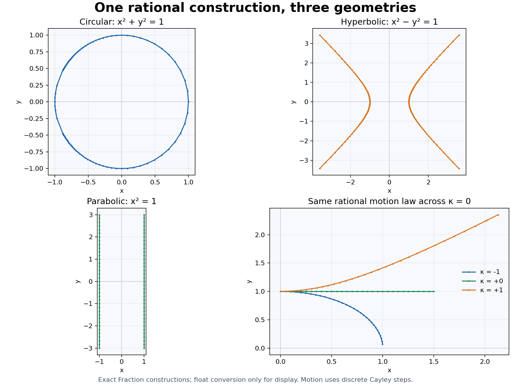
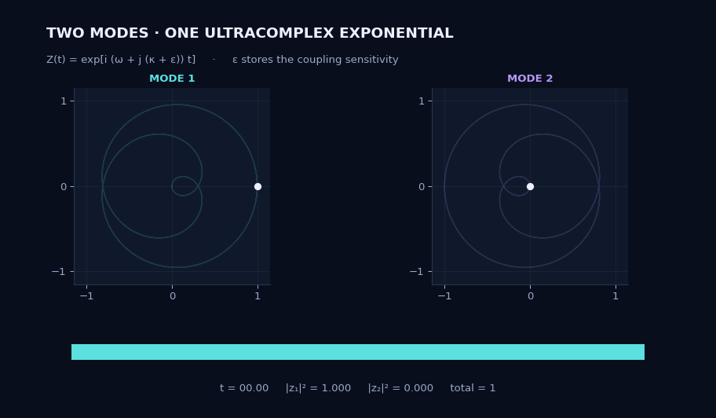

# Ultracomplex Math

**Circular, hyperbolic and parabolic geometry — united in one eight-dimensional algebra.**

A Python library by **Philipp Kolodziej** for exploring what these geometries can do together: exact rational constructions, mixed trigonometry, rotations, boosts, shears, coupled motion and projective transformations. Derivatives arise naturally from the same structure.

$$\mathcal A_K=K[i,j,\varepsilon]/(i^2+1,\;j^2-1,\;\varepsilon^2),\qquad ij=ji,\quad i\varepsilon=\varepsilon i,\quad j\varepsilon=\varepsilon j.$$

Choose numerical real coefficients (`Ultra`) or exact rational coefficients (`ExactUltra`). The mixed directions `ij`, `eps*i`, `eps*j` and `eps*i*j` are first-class parts of the same number. The goal is a coherent mathematical toolbox that brings the strengths of all three algebras into shared computations.

**[Explore linked light and the Maxwell field in 3+1 dimensions](https://raw.githack.com/hoechp/ultracomplexmath/master/docs/gallery/maxwell.html)** · [Physics, exact Hopfion and Python examples](docs/maxwell.md)

**[Draw a loop and predict the returning square root](https://raw.githack.com/hoechp/ultracomplexmath/master/docs/gallery/field-loops.html)** · [Download the offline lab](docs/gallery/field-loops.html)

**[Follow a square root around a loop in your browser](https://raw.githack.com/hoechp/ultracomplexmath/master/docs/gallery/polar-motion.html)** · [Polar coordinates, roots and dynamics in Python](docs/polar-motion.md)

[Get started](docs/getting-started.md) · [Documentation](docs/README.md) · [Showcase](docs/gallery/README.md) · [Research agenda](docs/research/README.md)

The [geometry inside the full union](docs/research/geometric-structure.md) explains its complete polar form, the shared structure of oscillators and optical systems, and its projective connection to a tangent quadric. It separates mathematical derivations from implemented APIs.



## See the union at work

| Explore | What comes together | Run from a checkout |
| --- | --- | --- |
| [Linked light](docs/maxwell.md) | Evolve electromagnetic initial data, compare moving observers and trace linked lines of an exact vacuum pulse | `python -m examples.maxwell` |
| [Five experiments](docs/five-experiments.md) · [Open the lab](https://raw.githack.com/hoechp/ultracomplexmath/master/docs/gallery/five-experiments.html) | Count rational roots, continue a field, trace a ruled surface, measure polarization and hear a zero divisor | `python -m examples.five_experiments` |
| [Four bars at dead centre](docs/four-bar.md) | Find the two finite assembly motions hidden in one singular pose, then try a velocity that fails at second order | `python -m examples.four_bar` |
| [Through the pole](https://raw.githack.com/hoechp/ultracomplexmath/master/docs/gallery/projective-paths.html) | Follow two projective channels through infinity and a zero of the reflected optical field | `python -m examples.projective_paths` |
| [Draw a field loop](docs/polar-motion.md#draw-your-own-field-loop) | Draw around either or both singularities of `F(z) = z − j` and compare the two phase lifts | `python -m examples.field_loops` |
| [Winding and critical damping](docs/polar-motion.md) | Follow a root from 1 to −j, then vary the damping of a spring or an RLC circuit | `python -m examples.polar_motion` |
| [Engineering showcase](docs/gallery/impact.md) | Optical tolerances, impedance diagnostics and vibration settling, with independent references | `python -m examples.impact` |
| [Formula compression](docs/formula-compression.md) | A complex solution and two sensitivities in one model expression; exact residual and cost audit | `python -m examples.impact --only formulas` |
| [UltraField](docs/fields.md) | Values in (3+1) dimensions, slices, sensitivity and fields on curved surfaces | `python -m examples.fields --animate` |
| [Exact geometry](docs/unified-geometry.md) | Rational rotations, boosts, shears, intersections and projective maps | `python -m examples.exact_geometry --plot` |
| [Coupled motion](docs/gallery/README.md#coupled-motion-and-sensitivity) | Complex phase, split coupling and dual parameter derivatives | `python -m examples.gallery --only coupling` |
| [Waves and inverse problems](docs/gallery/applications.md) | Travelling waves, robot Jacobians and interference-based geometry recovery | `python -m examples.applications` |
| [Trigonometric atlas](docs/gallery/README.md#trigonometry-and-angles) | The same function in circular, hyperbolic, parabolic and mixed directions | `python -m examples.gallery --only cosine` |
| [Geometric structure](docs/research/geometric-structure.md) | Full polar form, critical motion, polarization and projective tangent geometry | `python tools/geometric_structure_probe.py` |
| [Research investigations](docs/research/novelty.md) | Powered Toeplitz block ranks, exact critical-jet flow and small-component reciprocal experiments | `python tools/novelty_probe.py` |



The [geometry lab](https://raw.githack.com/hoechp/ultracomplexmath/master/docs/gallery/lab.html) and [engineering lab](https://raw.githack.com/hoechp/ultracomplexmath/master/docs/gallery/impact-lab.html) run in your browser. The [gallery](docs/gallery/README.md) also includes standalone HTML for offline use. Every numerical plot is reproducible, with model assumptions and independent checks in the showcase.

The new [engineering lab](docs/gallery/impact-lab.html) adds four interactive tabs: optical thickness/angle tradeoffs, measurement-band information, damping through the critical point, and a formula-compression audit. Its [guide](docs/gallery/impact.md) states what the synthetic experiments establish and where the models stop. The strongest demonstrated simplification is carrying a solution and its derivatives in one composable expression; no runtime advantage is claimed.

## Try it

Python **3.12+**. The mathematical core has **no external dependencies**. From the repository root:

```sh
python -m venv .venv
. .venv/bin/activate
python -m pip install -e .
python -m ultracomplexmath 'exp(i*j*(1+eps))'
python -m ultracomplexmath --exact '(1/3+i+j+eps)^3' --json
```

Circular, hyperbolic and parabolic factors compose within the same number system:

```python
from ultracomplexmath import I, J, EPS, Ultra

rotation = (I * 0.6).exp()
boost = (J * 0.35).exp()
relative_phase = (I * J * 0.2).exp()
v = Ultra(real=0.4, j=-0.2, i=0.1, ij=0.3)
shear = (EPS * v).exp()
value = 2 * rotation * boost * relative_phase * shear
assert value.isclose(2 * (I * 0.6 + J * 0.35 + I * J * 0.2 + EPS * v).exp())
```

Exact geometry uses the same algebraic laws without rounding coefficients:

```python
from fractions import Fraction as F
from ultracomplexmath import CIRCULAR, QI, QJ, QEPS, QONE, evaluate_exact

rotation = CIRCULAR.cayley(F(1, 2))
assert rotation == CIRCULAR.exact(F(3, 5), F(4, 5))
x = QONE + QI / 3 + QJ / 7 + QEPS / 11
assert x * x.inverse() == QONE
assert evaluate_exact("0.1 + 0.2 - 0.3") == 0 * QONE
```

Install plotting with `python -m pip install -e '.[plot]'`. Run `ultracomplex-gui --view domain --formula 'cos(x)'` for an editable desktop explorer. See [setup and examples](docs/getting-started.md) for other platforms and views.

## What is available

| Area | Implemented | Important boundary / next step |
| --- | --- | --- |
| Scalar arithmetic | Full eight-component numerical and rational arithmetic; integer powers; inverses | Zero divisors have no inverse; rational coefficients do not include irrational results |
| Functions and calculus | Numerical elementary/inverse functions, logarithm branches, first variations, intensity and phase derivatives | Stable small-component evaluation is complete for neither all functions nor all scales; general higher-derivative API is open |
| Exact mathematics | Fraction formulas/JSON, matrices, complete linear solution families, polynomial arithmetic and Hermite interpolation | General rational powers, symbolic algebraic numbers and modular hypercomplex coefficients remain open |
| Geometry | Intrinsic planar metrics/sectors, exact Cayley isometries, circle intersections and pinned planar bar constraints | General conic intersections, 3D poses and higher-order rigidity remain open |
| Transformations | Noncommuting `ModeOperator`, Möbius maps, unimodular projective points and mixed charts | Constant numerical generator flows include first variations. Sampled paths support automatic chart changes |
| Space and time | `LocatedUltra`, rule-defined `UltraField`, 0–n spatial axes, separate time, slices, grids and optional NumPy/xarray adapters | Real coordinates are independent of the scalar algebra; numerical fields and explicit coordinate maps |
| Surface fields | Torus and Möbius strip, induced metric, tangent gradients, Laplace–Beltrami, area quadrature and seam diagnostics | Static parametric surfaces; no general atlas, boundary solver or automatic physical transport |
| Applications | Tested optical stacks, coating-impedance fits, critical damping, waves, robotics, interference and root basins | Specified models with independent references; no real-device calibration or general engineering solver |

The ambition is broad; operation domains remain explicit. The scalar algebra is not a field in the algebraic sense (it has zero divisors), and has no compatible total order. This differs from a spatial field of values such as `UltraField`. See the [mathematical foundation](docs/mathematics.md), [operation atlas](docs/research/operations.md) and [prioritized gaps](docs/research/roadmap.md).

## Where next?

Version 0.6.0 ships unit polar decomposition, lifted root paths, singular root families and continuous constant-generator dynamics. The development branch after 0.6.1 includes [sampled projective paths](docs/unified-geometry.md#follow-a-path-through-a-pole) and [exact linkage constraints](docs/four-bar.md). Version 0.6.1 adds the freehand field loop, CLI polar and root views, and a [rank reduction for every positive power](docs/research/higher-power-rank.md) with an explicit third-power classification. The [research review](docs/research/README.md) compares all seven nonempty combinations of the three base algebras, names missing functionality and gives acceptance criteria. Reliable derivatives remain part of this toolkit, alongside the geometries themselves.

Development and verification: [CONTRIBUTING.md](CONTRIBUTING.md). API orientation: [docs/api.md](docs/api.md). Release changes: [CHANGELOG.md](CHANGELOG.md).

Licensed under [0BSD](LICENSE). [Project scope](docs/scope.md) explains the separation of unrelated algorithm experiments; [history and compatibility](docs/history.md) preserve access to the original work without crowding the current guides.
