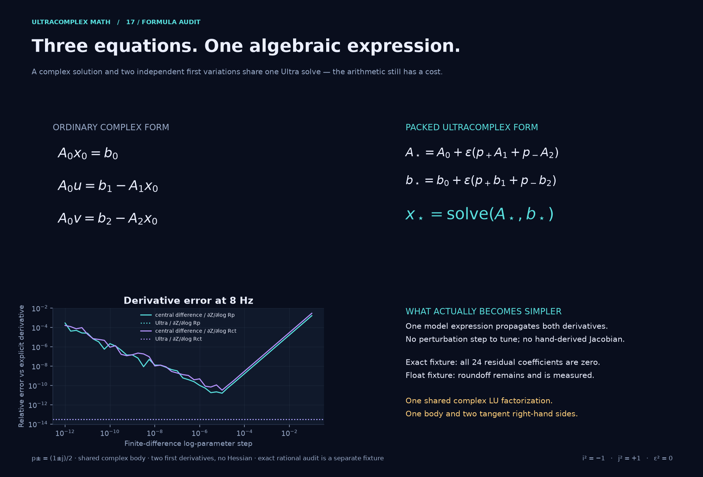
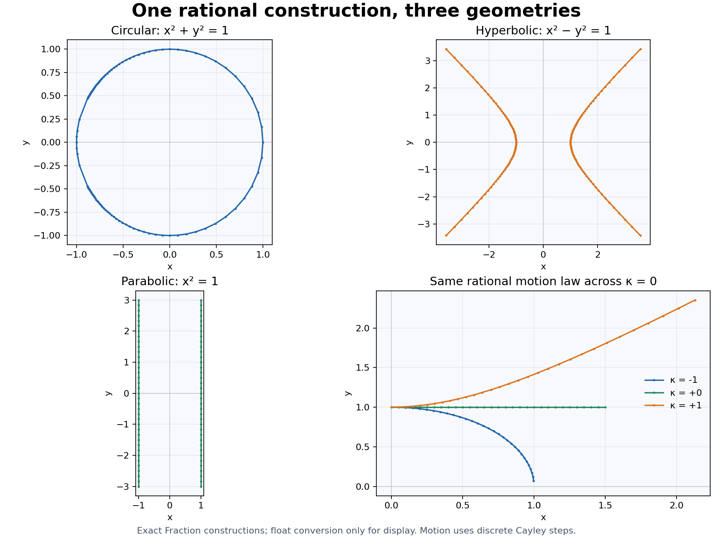
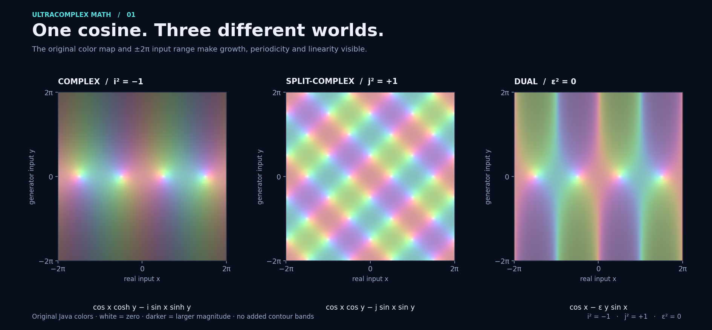
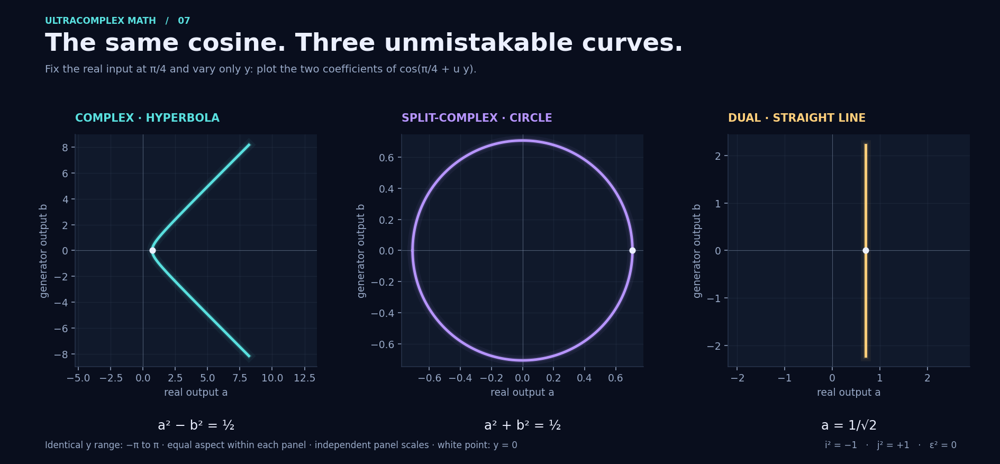
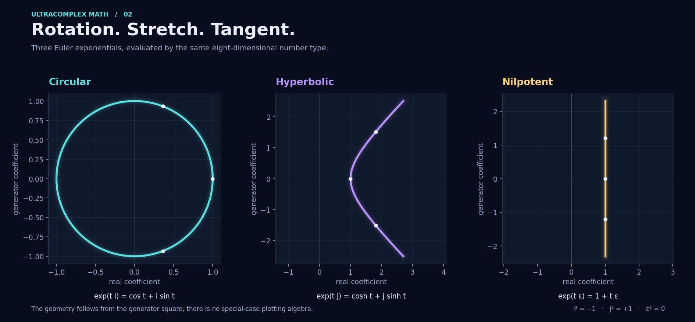
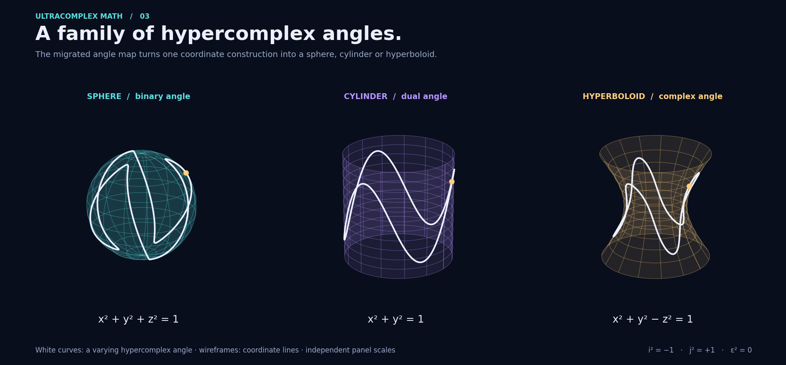
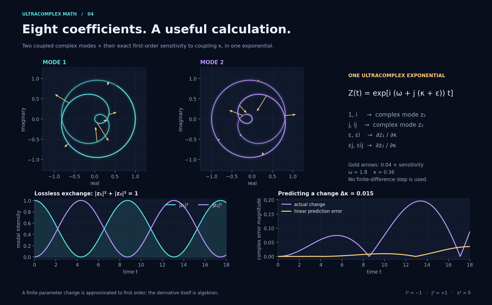
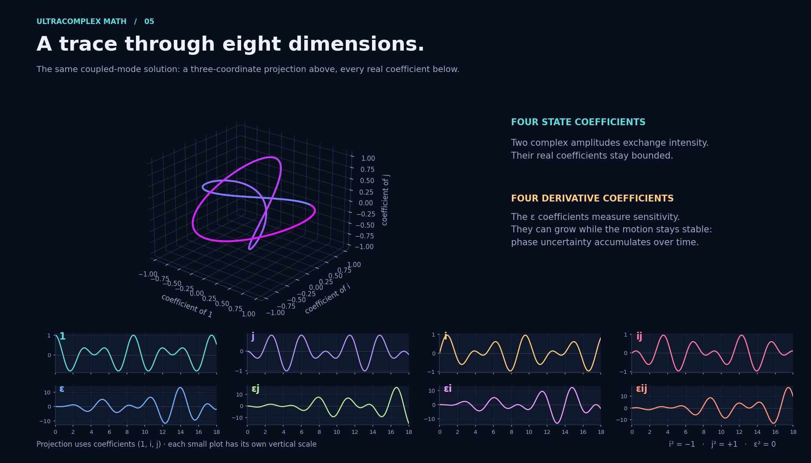
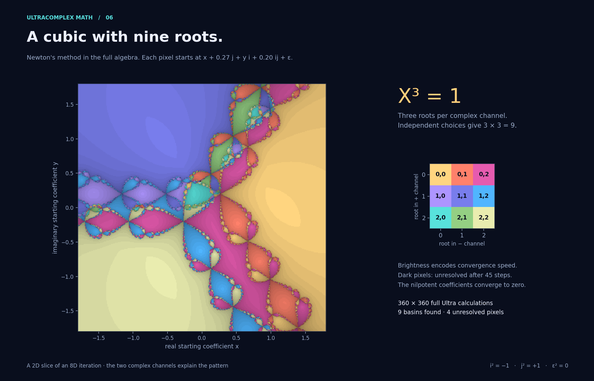
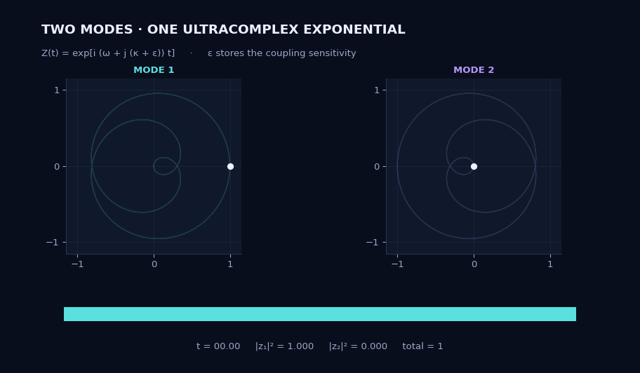

# Visual showcase

[Documentation](../README.md) · [Engineering lab](impact.md) · [Waves and robotics](applications.md) · [Exact geometry](../unified-geometry.md) · [Research](../research/README.md)

**[Linked light](https://raw.githack.com/hoechp/ultracomplexmath/master/docs/gallery/maxwell.html)** lets you rotate linked Hopfion field lines, move through slices of electromagnetic waves and compare observers at the same event. [Equations and Python](../maxwell.md) · [Offline lab](maxwell.html).

**[Start with the winding-root and damping lab](https://raw.githack.com/hoechp/ultracomplexmath/master/docs/gallery/polar-motion.html)** · [Open the geometry lab](https://raw.githack.com/hoechp/ultracomplexmath/master/docs/gallery/lab.html) · [Open the engineering lab](https://raw.githack.com/hoechp/ultracomplexmath/master/docs/gallery/impact-lab.html)

**[Listen to a zero divisor](https://raw.githack.com/hoechp/ultracomplexmath/master/docs/gallery/five-experiments.html#sound)** and explore exact roots, three field equations, a ruled quadric and polarization in the same [five-experiment lab](../five-experiments.md).

**[Four bars at dead centre](https://raw.githack.com/hoechp/ultracomplexmath/master/docs/gallery/four-bar.html)** follows two assemblies through their common toggle. Choose a branch and test a velocity that passes the linearized equations. [Offline lab](four-bar.html) · [Exact model and derivation](../four-bar.md).

**[Through the pole](https://raw.githack.com/hoechp/ultracomplexmath/master/docs/gallery/projective-paths.html)** shows simultaneous chart and tangent readouts for a two-pole path and reflection at the Brewster angle. [Offline lab](projective-paths.html) · [Python and model guide](../unified-geometry.md#follow-a-path-through-a-pole).

**[Draw a field loop](https://raw.githack.com/hoechp/ultracomplexmath/master/docs/gallery/field-loops.html)** and predict which root returns around the two branch points of `F(z) = z − j`. The [standalone field lab](field-loops.html) works offline.

The [Python guide](../polar-motion.md) reproduces the winding and damping experiments. For offline use, download the [standalone file](polar-motion.html).

Explore the union through exact constructions, three kinds of trigonometry, coupled motion and inverse problems. Each figure is computed from the library and accompanied by its formulas, interpretation and independent checks.

| Start with | What to notice |
| --- | --- |
| [Three engineering applications](impact.md) | Optical tolerances, impedance identification and critical damping combine response, derivatives and invariants |
| [Formula compression](../formula-compression.md) | Three derivative equations become one algebraic solve; exactness and computational cost remain explicit |
| [UltraField: space, time and surfaces](fields.md) | One rule generates spatial slices, sensitivity maps and seam-compatible surface values |
| [Exact geometry](../unified-geometry.md) | Rational rotations, boosts and shears share one construction |
| [Trigonometry and angles](#trigonometry-and-angles) | The same operation has different geometric behavior in C, S and D |
| [Coupled motion](#coupled-motion-and-sensitivity) | Phase, split coupling and parameter sensitivity occupy all eight coefficients |
| [Waves, robotics and interference](applications.md) | Geometric and field calculations feed concrete inverse problems |
| [Root basins](#why-a-cubic-has-nine-roots-here) | Zero divisors change familiar polynomial root counting |

## Engineering lab



The [new showcase](impact.md) adds three physical models and a fourth formula audit. Open the [offline engineering lab](impact-lab.html) to vary coating thickness and incidence angle, inspect measurement frequencies, and sweep a mode through critical damping. The guide includes four full figures, concrete synthetic results, model equations and reproduction commands.

## Exact geometry



The circular factor `(3/5,4/5)`, hyperbolic factor `(5/3,4/3)` and parabolic factor `(1,1)` all come from the same Cayley parameter 1/2. Their intrinsic quadrances equal one exactly. The fourth panel shows coupled rational steps through negative, zero and positive generator parameter. These are discrete Cayley maps; continuous-time evolution is a separate next step.

Read the [geometry guide](../unified-geometry.md) or run `python -m examples.exact_geometry --plot`. Computation and invariant checks use fractions; plotting alone converts coordinates to float.

## Trigonometry and angles



For the same real inputs x and y:

| Input | Output |
| --- | --- |
| x + iy | cos(x) cosh(y) − i sin(x) sinh(y) |
| x + jy | cos(x) cos(y) − j sin(x) sin(y) |
| x + εy | cos(x) − εy sin(x) |

Every pixel calls `Ultra.cos()`, on the square
`−2π ≤ x,y ≤ 2π`. The coefficient-direction color mapping uses this convention: the **Euclidean direction of the two output coefficients** controls
the RGB phases, zero is white, and large magnitudes become darker. This display
angle does not assert a multiplicative Euclidean norm or an ordinary complex
argument for the split-complex and dual algebras.

The formulas explain the differences directly: complex cosine grows
exponentially along the imaginary direction, split-complex cosine stays bounded
and is periodic in both inputs, and the dual coefficient varies linearly with y.



Fixing `x = π/4` makes a particularly simple coefficient-plane comparison:
complex cosine follows a hyperbola branch, split-complex cosine a circle, and
dual cosine a line. These are the **outputs of cosine**, so the circle/hyperbola
roles differ from the generator exponentials below. All three use
`−π ≤ y ≤ π`, with equal aspect within each panel and independent panel scales.

### Three Euler geometries



`(t * unit).exp()` gives a circle for `I`, one branch of a hyperbola for `J`,
and a straight line for `EPS`:

$$e^{it}=\cos t+i\sin t,\qquad
  e^{jt}=\cosh t+j\sinh t,\qquad
  e^{\varepsilon t}=1+\varepsilon t.$$

These are separate embedded subalgebras inside the same eight-dimensional type.

### Hypercomplex angles become surfaces



`geometry.vector_from_angle` maps
`a + u*b` to `(r(b) cos(a), r(b) sin(a), z(b))`:

| Angle type | r(b) | z(b) | Result |
| --- | --- | --- | --- |
| `Binary`, u² = +1 | cos(b) | sin(b) | x² + y² + z² = 1 |
| `Dual`, u² = 0 | 1 | b | x² + y² = 1 |
| `Complex`, u² = −1 | cosh(b) | sinh(b) | x² + y² − z² = 1 |

This is a useful unified parameterization. It uses a different construction
from the Euler curves above, so the pairing of an algebra with a surface is
different. The white paths vary both angle coordinates. Surface panels use
independent display scales. These coordinates do not, by themselves, supply
a general composition law for arbitrary 3D rotations.

## Coupled motion and sensitivity



Consider an ideal, lossless pair of coupled complex modes:

$$\dot z_1=i\omega z_1+i\kappa z_2,\qquad
  \dot z_2=i\kappa z_1+i\omega z_2,\qquad (z_1(0),z_2(0))=(1,0).$$

Package the modes as `Z = z1 + j*z2` and seed the coupling as `κ + ε`:

```python
from ultracomplexmath import I, J, EPS

omega, coupling, t = 1.8, 0.36, 5.0
Z = (t * I * (omega + J * (coupling + EPS))).exp()

z1 = complex(Z.real, Z.i)
z2 = complex(Z.j, Z.ij)
dz1_dk = complex(Z.eps, Z.eps_i)
dz2_dk = complex(Z.eps_j, Z.eps_ij)
```

The same exponential returns two complex states **and** both complex derivatives
with respect to κ. Differentiation is exact in the algebra, subject to ordinary
floating-point rounding. It does not choose a finite-difference step.

An independent reference is

$$z_1=e^{i\omega t}\cos(\kappa t),\qquad
  z_2=i e^{i\omega t}\sin(\kappa t).$$

It implies `|z1|² + |z2|² = 1`. The ε coefficients agree with the derivatives
of these formulas. A finite change is only approximated:

$$z(\kappa+\Delta\kappa)
  =z(\kappa)+\Delta\kappa\,\partial_\kappa z+O(\Delta\kappa^2).$$

The static chart compares the actual change with the prediction error for
mode 1; the interactive lab reports the Euclidean error over both modes.
The gold arrows in the static phase portraits show `0.04 * ∂z/∂κ`; the bottom
comparison uses the separately labelled `Δκ = 0.015`.



This demonstrates a compact representation for a symmetric linear system and
forward-mode automatic differentiation. It does not establish a computational
advantage over specialized complex-array code. The projection is labelled by
its three selected coefficients; the small plots expose all eight coefficients.
Derivative growth records accumulating phase sensitivity, not energy growth.
The 2D animation displays the two state modes; their derivatives are explored
in the static chart and interactive lab.

## Why a cubic has nine roots here



Every pixel iterates the full eight-component equation

$$X_{n+1}=X_n-\frac{X_n^3-1}{3X_n^2}$$

from `X0 = x + 0.27*j + y*i + 0.20*i*j + eps`. The residual threshold is
`||X³ − 1||₂ < 10⁻⁹`, including all nilpotent coefficients, with at most
45 updates. Noninvertible derivatives, numerical failures and unresolved
starts are dark. Brighter pixels reach the residual threshold sooner.

The explanation is the exact channel decomposition

$$p_\pm=(1\pm j)/2,\qquad
  X=(z_++\varepsilon w_+)p_++(z_-+\varepsilon w_-)p_-.$$

`X³ = 1` requires each complex body `z±` to be a cube root of unity. Since
`3*z±²` is nonzero, both nilpotent parts must be zero. Thus there are exactly
`3 × 3 = 9` roots, indexed by the two channel choices in the legend. Their
explicit construction in the library is:

```python
from cmath import exp, pi
from ultracomplexmath import Ultra, ONE

roots = [
    Ultra.from_channels((exp(2j * pi * a / 3), 0), (exp(2j * pi * b / 3), 0))
    for a in range(3)
    for b in range(3)
]
assert all((root**3).isclose(ONE) for root in roots)
```

The image is a two-dimensional slice through an eight-dimensional iteration.
Its structure follows from the two complex Newton maps; it is not evidence
of a newly discovered class of fractals. This algebra has zero divisors, so
the familiar field restriction on the number of roots of a polynomial does
not apply.

## Verification and source

- [Renderer and all numerical sampling](../../examples/gallery.py)
- [Three further applications, formulas and model assumptions](applications.md)
- [Application renderer](../../examples/applications.py)
- [HTML template](../../examples/gallery_lab.html)
- [Independent mathematical tests](../../tests/test_gallery.py)
- [Independent application tests](../../tests/test_applications.py)
- [Numerical verification from the full render](verification.json)
- [Application verification from the full render](applications-verification.json)

`verify_math()` checks the closed-form solution and derivatives, intensity
conservation, all nine root residuals, and the second-order remainder of the
linear prediction. The tests also check all three cosine identities, the
three implicit surface equations, Newton convergence with nonzero nilpotent
seeds and explicit treatment of a singular derivative.

## Interactive laboratory



[Download the standalone HTML](https://raw.githubusercontent.com/hoechp/ultracomplexmath/master/docs/gallery/lab.html) and open the saved file locally. It includes sliders, trajectories, derivatives and finite-change predictions, with no network dependency. GitHub displays HTML source rather than running it.

## Reproduce everything

From the repository root, with Python 3.12+:

```sh
python -m pip install -e '.[plot]'
python examples/gallery.py
python -m examples.applications
python -m examples.impact
# Faster preview in a separate directory:
python examples/gallery.py --quick --output /tmp/ultra-gallery
python -m examples.applications --quick --output /tmp/ultra-applications
# Rebuild one demonstration:
python examples/gallery.py --only coupling
python examples/gallery.py --only newton
python -m examples.applications --only robot
```

The normal render evaluates 360 × 360 samples per domain image. The Newton
image can take several minutes because **every pixel runs the actual `Ultra`
arithmetic**, including its nilpotent coefficients. `--quick` reduces sampling.
The lab stores 21 coupling values and 241 time samples computed by `Ultra.exp()`;
JavaScript only draws the data and forms the first-order prediction. No CDN,
server, external font or alternative algebra implementation is required.

For the project's pinned Python packages, use `requirements-plot.lock` or
`uv sync --frozen --extra plot`. The core remains dependency-free. NumPy,
Matplotlib and Pillow are used by this optional example to arrange data and
render graphics. Pixel appearance can differ between plotting-library versions.
The application renderer uses 145 × 400 wave samples, 361 robot targets and
a 260 × 260 interference grid in its full render.
