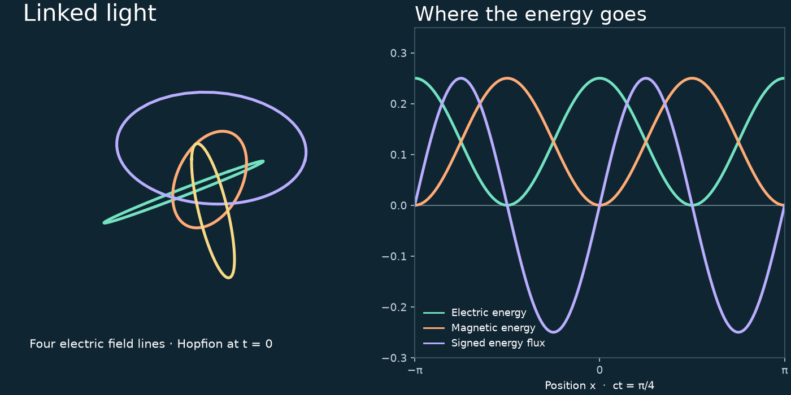

# Linked light and Maxwell fields in 3+1 dimensions

[Open the laboratory](https://raw.githack.com/hoechp/ultracomplexmath/master/docs/gallery/maxwell.html) · [Offline HTML](gallery/maxwell.html) · [Original project motivation](history.md)

A Hopfion is a pulse of light whose electric field lines are linked in space. The laboratory draws four of those curves. In the spacetime explorer you can follow its energy, compare it with a standing wave and change the observer measuring the fields. Both experiments use the same representation.



## One law for six real field components

At each event $(x,y,z,t)$ put $h=ij$ and define the three-component vector $\mathbf F=\mathbf E+h\mathbf B$. Each component is an ultracomplex number. In the units used here the speed of light, permittivity and permeability are one. Vacuum Maxwell evolution and the two divergence constraints become

$$\boxed{\partial_t\mathbf F=-h\,\nabla\times\mathbf F,\qquad\nabla\cdot\mathbf F=0.}$$

Because $h^2=-1$, the scalar and $h$ coefficients give $\partial_t E=\nabla\times B$ and $\partial_t B=-\nabla\times E$. The same multiplication gives both Lorentz invariants at once,

$$\mathbf F\cdot\mathbf F=(|E|^2-|B|^2)+2h(E\cdot B).$$

This is the classical Riemann–Silberstein construction expressed in the mixed plane. What does the larger algebra add?

| Operation | Role in this model |
| --- | --- |
| Evaluate $j$ at +1 and −1 | The two channels carry the self-dual and anti-self-dual combinations $E+iB$ and $E-iB$. |
| Fourier phase $e^{i k\cdot x}$ | Spatial phase and electric/magnetic mixing use distinct commuting units. Complex electric **and** magnetic Fourier amplitudes can be recovered separately. |
| Add $ε$ to a coordinate or amplitude | A tangent travels with the field. Seeding exact coordinates checks the local Maxwell equations, including at points where a component vanishes. |
| Apply a Lorentz boost | Along a fixed axis the transverse generator $-h(n\times)$ squares to +1. Its two null directions scale by reciprocal factors $e^{\pm ρ}$. |

At a real event the two channels are complex conjugates. On a Fourier coefficient that reality condition relates **opposite wavevectors**. The physical projection retains coefficients 1 and $ij$ and their ε variations. Three spatial components and independent spacetime coordinates are necessary to define curl and flux. This model gives the eight coefficients algebraic roles within each Fourier component.

For SI inputs use $B_{\mathrm{model}}=cB_{\mathrm{SI}}$ and $t_{\mathrm{model}}=ct_{\mathrm{SI}}$ with positions in metres. Multiply the returned energy density by $\epsilon_0$ and flux by $c\epsilon_0$. All lab axes use normalized units.

## Build a field from initial data

```python
from math import pi
from ultracomplexmath import EPS, MaxwellMode, MaxwellField

# E_y(x,0) = cos(x); B(x,0) = 0. Give the initial amplitude a variation of 1.
standing = MaxwellField([MaxwellMode((1, 0, 0), (0, 1 + EPS, 0), (0, 0, 0))])
s = standing.at(pi / 4, 0, 0, time=pi / 4)
assert s.electric[1].isclose((1 + EPS) / 2)
assert s.magnetic[2].isclose((1 + EPS) / 2)
assert s.poynting[0].isclose(0.25 + 0.5 * EPS)
assert standing.component("y").slice(z=0, t=pi / 4).at(pi / 4, 0).value == s.components[1]
```

For a single real harmonic the initial fields are $\Re(E_k e^{ik\cdot x})$ and $\Re(B_k e^{ik\cdot x})$. Both may have arbitrary complex polarizations and complex first variations. Their longitudinal components must vanish, independently for each layer. A uniform mode accepts real initial fields. Add modes with any non-collinear wavevectors. `MaxwellMode.traveling(k,E)` constructs a forward wave with $B=\hat k\times E$.

For the packed amplitude $A=E_k+hB_k$, evolution is $\dot A=j k\times A$. On the transverse subspace its square is $-|k|^2$. Consequently the complete finite-time propagator is

$$A(t)=A(0)\cos(|k|t)+j\,[\hat k\times A(0)]\sin(|k|t).$$

The zero mode stays constant. The implementation evaluates this solution directly in binary64. There is no integration time step. Spatial truncation, roundoff and phase resolution still matter. Mode summation is intended for sparse spectra and off-grid probes. There are no material interfaces, charges, currents or absorbing boundaries in this solver.

### Start with sampled electric and magnetic fields

With the optional arrays extra, `periodic_maxwell_field` accepts real arrays of shape `(nx, ny, nz, 3)` sampled without the duplicate endpoint over three positive periods. It reconstructs the real modes from conjugate Fourier pairs. The resulting field can be evaluated at arbitrary coordinates and times. Matching optional `electric_tangent` and `magnetic_tangent` arrays seed a first variation.

```python
# Optional: python -m pip install -e '.[arrays]'
import numpy as np
from ultracomplexmath import periodic_maxwell_field

n = 7
x = 2 * np.pi * np.arange(n) / n
E = np.zeros((n, 3, 3, 3))
E[..., 1] = np.cos(x)[:, None, None]
field = periodic_maxwell_field(E, np.zeros_like(E), (2 * pi, 2 * pi, 2 * pi))
assert field.at(0.3, 0.2, -1, time=0.4).electric[1].isclose(np.cos(0.3) * np.cos(0.4))
```

The adapter drops amplitudes below the larger of the supplied absolute tolerance and a per-layer roundoff floor (32 machine epsilons times the largest absolute input). It removes divergence residuals within roundoff, and rejects resolved longitudinal content. A non-negligible mode on an even grid's Nyquist plane has ambiguous off-grid continuation. Use a finer grid to resolve it. The adapter imports a spectrum once. Dense, repeated full-grid output would require a batched inverse-FFT backend.

## Energy and the moving observer

Energy density $u=(|E|^2+|B|^2)/2$ and flux $S=E\times B$ obey $\partial_t u+\nabla\cdot S=0$. The invariant energy density is

$$w=\sqrt{u^2-|S|^2}=\tfrac12\sqrt{(|E|^2-|B|^2)^2+4(E\cdot B)^2}.$$

A nonzero null field has $w=0$ and $|S|=u$. No finite boost stops its energy flow. For $w>0$, a boost along $S$ of rapidity $\tfrac12\operatorname{asinh}(|S|/w)$ cancels the flux. Along this axis both transverse fields mix, giving $S'_\parallel=|S|\cosh(2ρ)-u\sinh(2ρ)$. This gives an observable way to distinguish an interference field from a single traveling wave even at the same energy density.

```python
from ultracomplexmath import MaxwellState

sample = MaxwellState.from_fields((0, 2, 0), (0, 0, 1))
direction, rapidity = sample.energy_rest_boost()
rest = sample.boosted(direction, rapidity)
assert all(abs(v.real) < 1e-14 for v in rest.poynting)
assert rest.energy.isclose(1.5) and rest.invariant.isclose(sample.invariant)
```

The boost compares observers at the **same event**. The spacetime explorer keeps its sampling grid in the lab frame. `.energy_rest_boost()` uses the body fields. For nearly null numerical input its classification and recovered rapidity depend on how accurately the two invariants are known.

## An exact pulse with linked lines

The analytic solution here is a unit-scale electromagnetic Hopfion. Following Kedia's convention up to a common normalization, set

$$a=x-hy,\quad b=t-h-z,\quad d=x^2+y^2+z^2-(t-h)^2,$$
$$\mathbf F=d^{-3}\big(b^2-a^2,\;-h(a^2+b^2),\;2ab\big).$$

Its denominator cannot vanish at real events. The imaginary part of $d$ forces $t=0$ at a proposed zero, and the real part there is $1+x^2+y^2+z^2$. Expanding the three squared numerators gives zero identically, proving $\mathbf F\cdot\mathbf F=0$. At $t=0$ the energy profile is $(1+r^2)^{-4}$ with total energy $4π\int_0^\infty r^2(1+r^2)^{-4}dr=π^2/8$ in this normalization. Use `hopfion` for a numerical state and `exact_hopfion` for all three rational components and their directional derivatives.

```python
from fractions import Fraction as Q
from ultracomplexmath import QEPS, QI, QJ, QZERO, exact_hopfion

x, y, z, t = Q(1, 3), Q(-2, 5), Q(1, 2), Q(3, 4)


def derivative(axis):
    args = [x, y, z, t]
    args[axis] += QEPS
    return tuple(v.tangent for v in exact_hopfion(*args[:3], time=args[3]))


dx, dy, dz, dt = (derivative(k) for k in range(4))
assert dx[0] + dy[1] + dz[2] == QZERO
curl = (dy[2] - dz[1], dz[0] - dx[2], dx[1] - dy[0])
assert dt == tuple(-QI * QJ * v for v in curl)
```

Where do the drawn curves come from? Inverse stereographic projection lifts $(x,y,z)$ to $q=(2x,2y,2z,r^2-1)/(1+r^2)$ on the unit 3-sphere. The rotation $V(q)=(q_4,q_3,-q_2,-q_1)$ satisfies $V^2=-1$. Its great circle is $q\cos s+V(q)\sin s$. After projection back to space, twice its velocity equals $(r^2-1-2x^2,\,2(z-xy),\,-2(y+xz))$. Division by $(1+r^2)^3$ gives exactly the electric field at $t=0$. The plotted curves therefore follow the field itself. They are instantaneous field lines. Energy transport is given separately by $S$.

The generator takes rational points on each great circle and computes signed crossings between the resulting closed polygons in a rational oblique projection. Each of the six pairs in the four-curve test has linking number +1 in the indicated orientation. Reversing a curve changes the sign. The general link structure is the classical Hopf fibration. [Kedia, *On the Construction and Dynamics of Knotted Fields*](https://knowledge.uchicago.edu/record/783/files/Kedia_uchicago_0330D_13654.pdf) · [Bode, *Stable knots and links in electromagnetic fields*](https://link.springer.com/article/10.1007/s00220-021-04219-3).

## Reproduce

Run `python -m examples.maxwell` to rebuild the offline lab. Add `--figure` with the plotting extra to rebuild the figure. `python -m pytest tests/test_maxwell.py` checks the six real evolution components and both divergence laws, energy continuity, the two invariants under boosts, spectral reconstruction off-grid, redshift, exact Hopfion derivatives, field-line tangency and linking. The numerical finite-difference Maxwell/energy checks use three non-collinear waves and a constant background. The Hopfion tests use exact rational arithmetic.

The paired helicity descriptions, the Riemann–Silberstein field and the Hopfion are established physics. The implementation connects them through the project's own algebra, its exact coefficients and its 3+1 field interface. [Białynicki-Birula and Białynicka-Birula, *Beams of electromagnetic radiation carrying angular momentum*](https://arxiv.org/abs/quant-ph/0511011).
